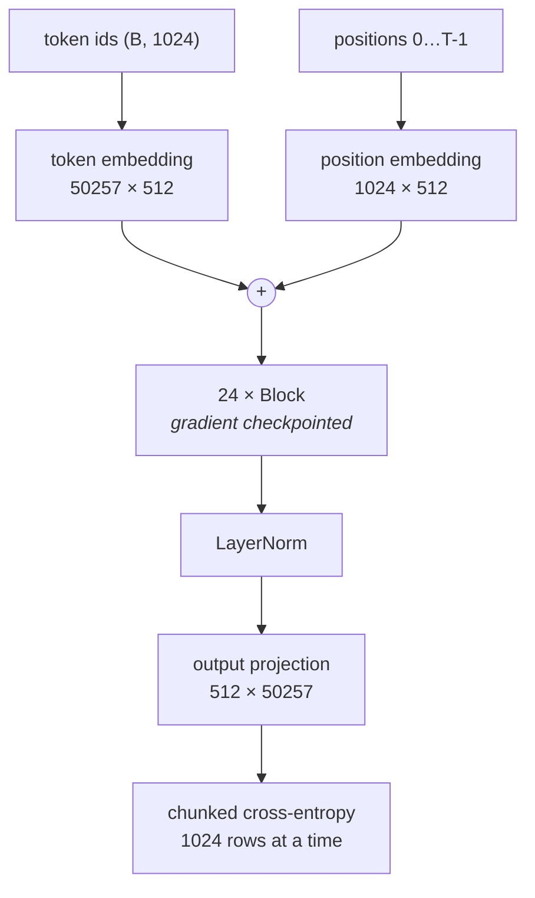
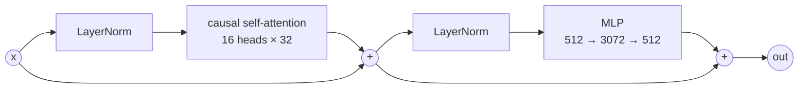
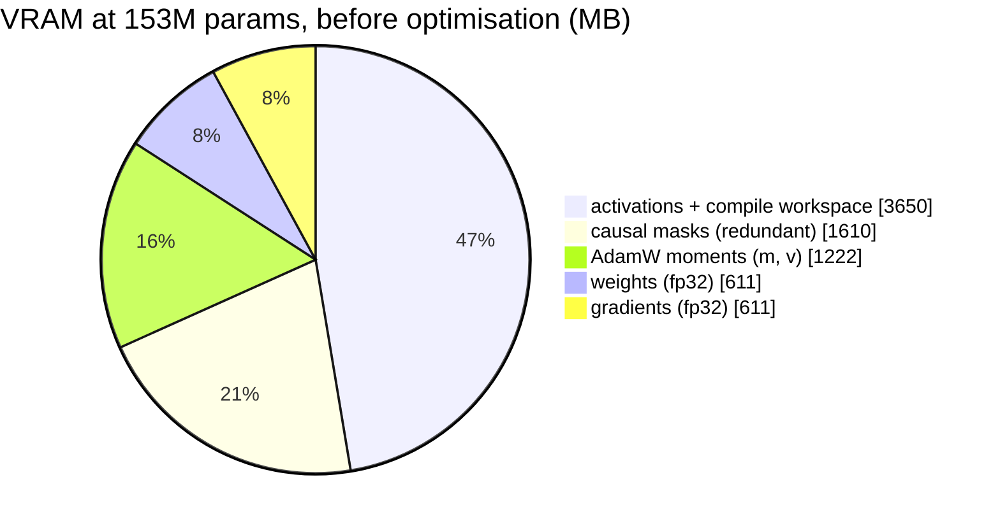

# A 153M-parameter transformer, pretrained from scratch on one consumer GPU

A decoder-only GPT-style language model written from scratch in PyTorch —
including hand-rolled multi-head causal self-attention — and pretrained from
random initialisation on roughly 2.5 billion tokens of filtered educational
web text.

All training was done on a **single AMD Radeon RX 7600 with 8GB of VRAM**, in
overnight sessions over several weeks. The engineering constraint, not the
model, is the point of the project: most of the work went into making a model
of this size train at all on a card this small.

> **Two models, one repository.** The results below are from **v1 (153M
> parameters)**, which is finished and is what the published weights contain.
> The code in this repository is currently configured for **v2 (204M
> parameters)**, a from-scratch retrain that is in progress — see
> [Current state](#current-state-of-this-repository).

## Result — v1, 153M parameters

| | |
|---|---|
| Parameters | **152,849,489** (GPT-2 small is 124M) |
| Best validation loss | **3.2659** (perplexity ≈ 26.2) |
| Training tokens | **~2.5B** (~16 tokens per parameter) |
| Iterations | ~1.25M at 2,048 tokens each |
| Dataset | [FineWeb-Edu](https://huggingface.co/datasets/HuggingFaceFW/fineweb-edu), the `sample-10BT` subset (a 10B-token sample, of which ~2.5B was consumed) |
| Tokenizer | GPT-2 BPE, 50,257 tokens (`tiktoken`) |
| Context length | 1,024 tokens |
| Hardware | 1 × RX 7600, 8GB, ROCm |

The token count is approximate: `micro_batch` was reduced from 8 to 4 to 2
during early training while diagnosing out-of-memory failures, so tokens per
iteration was not constant across the run.

Perplexity is reported on this model's own held-out split and is **not**
comparable to published GPT-2 numbers — different corpus, different
distribution. FineWeb-Edu is cleaner and more uniform than WebText, so lower
numbers come more easily.

### Architecture

| Setting | Value |
|---|---|
| `n_embd` | 512 |
| `num_blocks` | 24 |
| `n_head` | 16 |
| `head_size` | 32 (decoupled from `n_embd`; attention width 512) |
| `mlp_hidden` | 3072 (6× `n_embd`) |
| `block_size` | 1024 |
| Optimizer | AdamW, `betas=(0.9, 0.95)`, `weight_decay=0.01` |
| LR schedule | linear warmup → cosine decay, 6e-4 → 6e-6 |
| Gradient clipping | 1.0 (on unscaled gradients) |
| Precision | fp16 autocast with `GradScaler` |
| Effective batch | 64 sequences (`micro_batch=2` × `grad_accum=32`) |

The deep-and-narrow shape came from an earlier ablation at a ~15M parameter
budget, where spending parameters on depth and attention heads beat spending
them on embedding width. **That conclusion does not survive at this scale** —
benchmarking later showed `12×1024` to be both larger and 17% faster than
`24×512`. See [Current state](#current-state-of-this-repository).



Each of the 24 blocks, pre-norm with residual connections:



## What it can do

- **Fluent, grammatical English.** Reliable: agreement, punctuation, clause
  structure all hold together.
- **Topical coherence** across a couple of paragraphs.
- **Register matching.** It writes like an explanatory encyclopedia article,
  because that is what FineWeb-Edu is.
- **Weak recall of very common facts.** "The capital of France is Paris" is
  correct. Little beyond that tier is.

A representative sample, and a fair summary of the model's character:

> Tokyo is the capital of Japan and is located on the island of Hokusai in the
> far north of Japan (modern day Korea).

Correct core fact, confidently invented specifics.

## What it cannot do

These are structural, not prompting problems:

| Limitation | Cause |
|---|---|
| Answer questions or follow instructions | No instruction tuning. It is a base model: it continues text rather than responding to it |
| Produce reliable facts | 153M parameters on ~2.5B tokens. It confabulates names, dates and places freely |
| Arithmetic, logic, multi-step reasoning | Requires orders of magnitude more scale |
| Stop on its own | No `<\|endoftext\|>` token was inserted between documents during tokenization, so the model has never seen one and cannot predict one |
| Write code | Essentially none present in FineWeb-Edu |
| Hold a conversation | Base model, no dialogue format in training |

Left to sample freely it also falls into **verbatim repetition loops**, the
best-documented failure mode of small base models. Nucleus sampling (`top_p`)
plus a repetition penalty suppresses it; the UI exposes both.

## Running it

```bash
# train / resume (resumes automatically from the newest valid checkpoint)
HSA_OVERRIDE_GFX_VERSION=11.0.0 python3 -u main.py | tee -a training_log.txt

# generate from the command line
python3 generate.py "Photosynthesis is the process by which"

# web UI with sampling controls
python3 ui/server.py
```

See [ui/README.md](ui/README.md) for the interface.

## Files

| File | Purpose |
|---|---|
| `attention.py` | `Head` and `MultiHeadAttention` |
| `network.py` | `Transformer`, chunked loss, streaming sampler |
| `data.py` | FineWeb-Edu streaming download, tokenization, memory-mapped batching |
| `main.py` | Training loop, LR schedule, checkpoint/resume |
| `generate.py` | CLI sampling |
| `convert_checkpoint.py` | Converts per-head checkpoints to the batched-attention layout |
| `ui/` | Browser UI (standard library only) |

## Fitting 153M parameters into 8GB

Most of the project's difficulty. Where the 8GB actually went, before any of
the fixes below — note that the redundant causal masks were larger than the
model's own weights:



A 153M-parameter model needs **16 bytes per parameter resident** before a
single activation — weights, gradients, and AdamW's two moment buffers, all
fp32 — which is 2.44GB of an 8GB card spent before any work happens.

In rough order of how much each fix mattered:

**Chunked cross-entropy loss.** The output projection produces a
`(batch × seq, 50257)` logits tensor — ~786MB in one allocation at
`micro_batch=4`, independent of model size and untouched by gradient
checkpointing. `network.py` now computes the final projection and loss in
1024-row chunks, accumulating the sum, so peak memory no longer scales with
batch size at that step.

**Gradient checkpointing.** Storing activations for all 24 blocks
simultaneously does not fit. Each block's internals are now discarded after
its forward pass and recomputed during backward, trading roughly 20-30% extra
compute for the memory.

**Per-head causal masks were wasting 1.61GB.** The mask buffer was registered
inside each attention head, so 384 identical 1024×1024 float32 triangles sat
resident in VRAM — 20% of the card, and larger than the parameters
themselves. Replaced with `F.scaled_dot_product_attention(..., is_causal=True)`,
which masks internally.

**AdamW's hidden cost, and when it appears.** Parameters, gradients and
AdamW's two moment buffers need 16 bytes per parameter, all resident — 2.44GB
here before a single activation. Worse, Adam allocates its moment buffers
*lazily, on the first `optimizer.step()`*, which with gradient accumulation
is iteration 31, not iteration 0. Training appeared to run fine and then died
at a consistent iteration, which looked like a data bug and was not.

## ROCm-specific problems

Documented because they cost days and are poorly covered elsewhere.

**`gfx1102` has no prebuilt kernels.** The RX 7600 reports as `gfx1102`, which
the ROCm PyTorch build ships no compiled kernels for. The failure is a
segfault with no Python traceback, not a clear error. Fix:

```bash
HSA_OVERRIDE_GFX_VERSION=11.0.0
```

which presents the card as `gfx1100`. Required for anything to run at all.

**`expandable_segments:True` crashes the driver.** The allocator flag PyTorch
itself recommends in its OOM message triggers a hard GPU page fault and core
dump on this stack. It relies on virtual-memory APIs that are mature on CUDA
and not here — plausibly made worse by the GFX version override, since memory
mapping is more hardware-specific than compute kernels. Do not use it.

**The desktop and the training job share the GPU.** Under memory pressure the
display driver loses its own framebuffer allocation:

```
amdgpu_dm_plane_helper_prepare_fb *ERROR* Failed to pin framebuffer with error -12
```

`-12` is `ENOMEM`. This takes down the compositor and logs the user out.
Closing a second monitor measurably helps; routing display output through an
integrated GPU would fix it properly.

## Checkpointing, the hard way

The training drive is NTFS, mounted on Linux via `ntfs3`, bind-mounted into
Docker. That combination lost data three times, and each failure needed a
different fix:

1. **Non-atomic writes.** A crash mid-`torch.save()` corrupts the only
   checkpoint. Now writes to a temp file and `os.replace()`s it over the real
   one — rename is atomic, so a good checkpoint is never half-overwritten.
2. **Writes that looked saved but weren't.** A file can be readable with the
   correct size while existing only in the page cache; an abrupt container
   restart loses it. Now `fsync()`s before the rename.
3. **A `SIGKILL` mid-rename corrupted the file record itself.** Not
   recoverable by atomicity or `fsync` — the filesystem driver was interrupted
   mid metadata transaction, leaving a directory entry that `stat()` rejects
   with `EINVAL`. Now two checkpoints are written alternately, so a corrupted
   write costs 500 iterations instead of everything.

Also worth knowing: a bind mount does not pick up a filesystem mounted at the
host path *after* the container started. When the drive silently unmounted
mid-run, writes went to the directory underneath it — which lived on a 3GB
tmpfs — filling RAM and wedging Docker. And resuming is more memory-hungry
than starting fresh, because `optimizer.load_state_dict()` restores Adam's
moment buffers immediately rather than deferring them.

Ctrl+C now saves a checkpoint before exiting, and sessions stop after a set
number of iterations so a run ends on its own terms rather than being killed.

## Current state of this repository

The v1 results above are final. The code here is now configured for **v2**, a
from-scratch retrain currently running, after profiling established that the
bottleneck had moved from memory to throughput and that v1's architecture was
the wrong shape for the hardware.

| | v1 (finished) | v2 (in progress) |
|---|---|---|
| Parameters | 152,849,489 | **203,585,000** |
| Shape | 24 × 512 | **12 × 1024** |
| Attention | 16 heads × 32 | 16 heads × 64 (`n_embd // n_head`) |
| MLP hidden | 3072 (6×) | **4096 (4×)** |
| Activation | ReLU | **GELU** |
| Embeddings | untied | **tied** (input ↔ output, GPT-2 style) |
| Initialisation | PyTorch defaults | **GPT-2: std 0.02, residuals scaled 1/√(2L)** |
| Throughput | 10,527 tok/s | 8,076 tok/s |
| Peak VRAM | ~75% | ~87% |
| Token budget | ~2.5B | **10B** (≈38 overnight sessions) |

**Weights.** v1's trained weights are 611MB in the batched-attention layout
(`transformer_weights.batched.pth`, 152,849,489 parameters, fp32). They are
not in this repository — GitHub rejects files above 100MB and free Git LFS
allows 1GB total — so they are hosted separately. v2 will write
`transformer_weights_v2.pth` on each validation improvement.

Three findings from profiling drove the v2 design, each measured rather than
assumed:

**The architecture ablation inverted at scale.** v1's deep-and-narrow shape
came from a ~15M-parameter sweep. Re-benchmarked at this size, `12×1024` is
both larger (163M vs 153M) *and* 17% faster than `24×512` — fewer, wider
layers use the GPU better, and halving the depth halves the sequential chain
of kernel launches.

**Batch size stopped mattering.** Measured throughput is flat at ~11,400
tok/s from `micro_batch=8` through 16 — perfectly linear scaling, meaning the
GPU is saturated and spare VRAM cannot be converted into speed. This settled
an open question: capacity, not batch size, is what the remaining memory buys.

**Weight tying silently broke initialisation.** `nn.Embedding` defaults to
`normal_(0, 1)` while `nn.Linear` gives std ≈ 0.018, so sharing one matrix
between them left the output projection ~55× too large and the loss at
initialisation at **646 instead of ln(50257) = 10.82**. Caught by a smoke test
before the run started; fixed with GPT-2's explicit initialisation.

## What v2 changes, in detail

**1. Batch the attention heads — DONE.** `MultiHeadAttention` used to loop over
16 heads in Python, each doing three separate `(2048, 512) @ (512, 32)`
matmuls: 1,152 tiny matmuls per forward pass across the model, where one
batched projection per layer needs 72. Each was far too small to occupy the
GPU, making the model **launch-bound rather than compute-bound**. The heads are
now folded into the tensor shape and a single
`scaled_dot_product_attention` call covers all of them.

This was a lossless weight reshuffle rather than a retrain — stacking the 16
per-head `(32, 512)` matrices along dim 0 gives exactly the batched
`(512, 512)` matrix. `convert_checkpoint.py` performs the conversion and
proves it: it runs the old per-head computation and the new batched one on
identical input and compares.

```
tensors: 1782 -> 318  (24 attention layers)
weights: 152,849,489 -> 152,849,489   (identical)
dropped: 402,653,184 values of obsolete causal masks (1.61 GB)
max |old - new| = 4.768e-06   PASS
```

A side benefit: dropping the mask buffers took the weights file from
**2.22GB to 611MB**, which is what makes it distributable at all — GitHub
rejects files over 100MB and Git LFS caps at 2GB.

**2. Spend the freed 1.61GB on a larger `micro_batch` — to be measured.**
`micro_batch=2` could not saturate the GPU regardless of the above. It is now
set to 4 with `gradient_accumulation_steps=16`, holding the effective batch at
64 so learning behaviour is unchanged. The open question is how high it can go
before OOM, which is the measurement that should decide whether to grow the
model at all.

**3. More tokens — DONE.** `sample-10BT` was never exhausted; v1 consumed
about 2.5B of the ~9.9B tokens available. v2 targets 10B, roughly 1.1 passes
over the train split. `sample-100BT` is a one-string change, though 100B tokens is
200GB tokenized and needs the disk for it.

**4. Insert `<|endoftext|>` between documents** when tokenizing, so the model
can learn that texts end.

**5. Tie the input and output embeddings.** `ln_head.weight =
token_embedding_table.weight`, as GPT-2 does. Frees **25.7M parameters, 17% of
the model**, and is known to help at small scale because the embedding
receives gradient from both the input and output paths.

**6. Reconsider the shape.** 24 layers × 512 wide is deep-and-narrow; GPT-2
small is 12 × 768 at a comparable budget. The ablation that chose this shape
was run at ~15M parameters, and that result may not hold at 10× the scale.

### Should v2 have more parameters?

None of the fixes above change the parameter count by themselves — head
batching is a storage reshuffle, and freed VRAM and extra data don't alter
model size. So by default v2 stays at 153M.

Whether to grow it depends entirely on **how many more tokens the throughput
fixes actually buy**, because parameters and tokens should scale together. v1
trained at ~16 tokens per parameter; growing the model without growing the
token budget proportionally makes it *worse*, not better — a 300M model on the
same ~2.5B tokens would be badly undertrained at ~8 tokens/param.

The 8GB card sets a hard ceiling, since AdamW needs 16 bytes per parameter
resident before any activations:

| Params | Fixed VRAM | Left for activations | Tokens needed (~20/param) |
|---|---|---|---|
| 153M | 2.44GB | 5.56GB | 3.1B |
| 200M | 3.20GB | 4.80GB | 4.0B |
| 250M | 4.00GB | 4.00GB | 5.0B |
| 300M | 4.80GB | 3.20GB | 6.0B |
| 385M | 6.16GB | 1.84GB | 7.7B |

**Recommended order: fix throughput first, measure the new tokens/hour, and
only then pick a size.** If the fixes land a 3× speedup and the same
wall-clock budget, that's roughly 7.7B tokens, which would justify ~250-300M
parameters. If they land 1.5×, stay near 153M and simply train it properly.
Either way, weight tying and a better shape are free quality at any size, and
worth doing before reaching for a bigger number.
